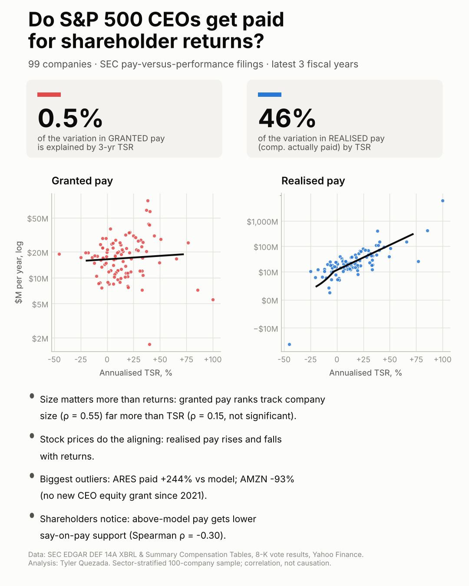

# CEO Pay vs. Performance: Do S&P 500 CEOs Get Paid for Shareholder Returns?

An end-to-end equity-research project: it pulls CEO pay from SEC pay-versus-performance XBRL filings,
rebuilds total shareholder return (TSR) independently from market data, tests whether pay tracks
returns, and investigates the biggest outliers with primary sources.

<p align="center"></p>

## Key findings

*100-company, sector-stratified S&P 500 sample; 496 CEO-years; primary window = each company's latest 3 fiscal years (mostly FY2023–FY2025).*

1. **Granted pay barely tracks returns.** 3-year annualised TSR explains **0.5%** of the variation in the
   pay boards award (Summary Compensation Table). After size and sector controls, +10 points of annual TSR goes with
   **+1.8%** pay (p = 0.69). Within companies, pay does not move with the same year's
   TSR (p = 0.81).
2. **Realised pay does.** TSR explains **46%** of the variation in *compensation actually paid* (CAP);
   +10 points of TSR ≈ **+58%** CAP (p < 0.001). Alignment runs through the stock CEOs already hold.
3. **Size matters more than performance.** Pay ranks track company size (Spearman ρ = 0.55) far more
   than TSR (ρ = 0.15). Excluding four founder/lump-grant companies (AMZN, COIN, META, PLTR), a modest
   link appears: +10 points of TSR ≈ +11.6% pay (p = 0.001) vs +24% for doubling market cap.
4. **The biggest "overpaid" outliers were strong performers.** Their excess pay traces to structural or one-time awards:
   Ares' fee-for-equity swap, Palo Alto's mega-grants (a failed 46% say-on-pay vote), Goldman's $80M retention RSUs.
   The "underpaid" end is founders and lumpy multi-year grants (Amazon, Palantir, Coinbase) whose *realised* pay is enormous.
   The classic high-pay/weak-return case appears in a misalignment screen: OMC (+54% vs model, TSR +3%/yr), PEP (+48% vs model, TSR -4%/yr), AEP (+46% vs model, TSR +11%/yr).
5. **Shareholders react to the level of pay, not to returns.** Above-model pay gets lower say-on-pay support
   (ρ = -0.30, p = 0.004); TSR is unrelated (p = 0.91). Failed votes in sample: MMM, PANW, SWKS.
6. **Proxy TSR contains errors.** Our independent TSR matches the proxy within 1 point for 84% of
   company-years, but 12 of 100 PvP tables are off by more than 10 points, mostly because earlier years
   were never rebased when the table rolled forward.
7. **Pay mix does not predict returns.** Median CEO pay is 73% equity; equity share is unrelated to TSR
   (ρ = -0.06).
8. **Excess pay did not predict future returns.** Point-in-time quintiles formed 2024-09-30 and 2025-09-30: rank correlation
   with later CAPM abnormal returns +0.03 and +0.03 (p = 0.78, 0.79).
   A raw-mean "signal" of +94 points came from one stock (BE).
9. **A long-short backtest earned no alpha.** Long the most-underpaid fifth, short the most-overpaid, rebalanced each 30 Sept (2024-10-01 to 2026-11-04): total -15.0%, Sharpe -0.49, CAPM alpha -1.8%/yr (t = -0.22, Newey-West). The raw loss is beta (1.25 vs 0.85).
10. **The pattern holds on the full S&P 500** (n = 481): TSR explains 0.9% of granted pay and 42% of realised pay; with five times the companies a small granted-pay link is detectable (+6.1% per 10 points, p = 0.028). Say-on-pay vs excess pay: ρ = -0.30; strategy IC +0.01 / +0.02; backtest alpha -0.4%/yr (t = -0.09). See the report appendix.

**How we know it is right:** XBRL pay found verbatim in the proxy for 100/100 companies,
301/301 pay-mix rows reconcile, 27/27 case-study facts verified in the filings,
permutation test p = 0.52 for granted pay, numpy re-estimation identical.
Details: [`output/validation/validation_report.md`](output/validation/validation_report.md) and [`docs/AI_USAGE_AND_QC.md`](docs/AI_USAGE_AND_QC.md).

## Interactive screener with a fact-checked AI analyst

Open [`output/screener/index.html`](output/screener/index.html) in any browser. You can:
- toggle granted vs. realised pay;
- filter by sector or flags;
- rank companies by pay vs. model;
- open any company's dossier (prediction, five-year table, pay mix, votes, data checks, SEC link).

When the page is opened as a claude.ai Artifact, an **AI analyst** answers questions using only that company's verified record. Every number in its answer is automatically matched against the data: matched figures turn green and unmatched ones red.

## Class project documents

| Document | Purpose |
|---|---|
| [`docs/PROJECT_OVERVIEW.md`](docs/PROJECT_OVERVIEW.md) | What we built, the problem, how it works, AI use, output, validity, why it matters |
| [`docs/AI_USAGE_AND_QC.md`](docs/AI_USAGE_AND_QC.md) | How AI was used, the QC stack, and 27 real errors caught |
| [`docs/DEFENSE_GUIDE.md`](docs/DEFENSE_GUIDE.md) | 60-second pitch, every component explained, expected questions with answers |
| [`docs/CHECKIN_1_GAME_PLAN.md`](docs/CHECKIN_1_GAME_PLAN.md) / [`CHECKIN_2_PROGRESS.md`](docs/CHECKIN_2_PROGRESS.md) | Talking points for the two check-ins |

### Outliers (residuals from `ln(granted pay) ~ TSR + ln(market cap) + sector`)

| Ticker | Company | 3-yr avg pay | Model | vs model | TSR/yr | Likely driver |
|---|---|---:|---:|---:|---:|---|
| ARES | Ares Management | $61.4M | $17.9M | +244% | +37% | Incentive-fee allocations swapped for restricted units (2024-25) |
| PANW | Palo Alto Networks | $79.3M | $24.7M | +222% | +38% | Large annual PSU grants after a 2023 one-time retention award |
| BKNG | Booking Holdings | $42.3M | $15.2M | +179% | +39% | High target pay; peer group includes mega-cap tech |
| AMZN | Amazon | $1.7M | $22.9M | -93% | +40% | No CEO equity grant since the 2021 promotion award |
| PLTR | Palantir Technologies | $5.6M | $19.6M | -72% | +203% | Founder; pre-IPO mega-grant, no new awards |
| COIN | Coinbase | $7.2M | $16.6M | -57% | +86% | Founder; 2020 performance option, no new awards |

Full case studies with SEC and news citations are in [`output/report/report.pdf`](output/report/report.pdf).

## Deliverables

| Path | What |
|---|---|
| [`output/report/report.pdf`](output/report/report.pdf) / [`.md`](output/report/report.md) | 5-page equity-research write-up |
| [`notebooks/analysis.ipynb`](notebooks/analysis.ipynb) | Full walkthrough; runs top to bottom offline |
| [`output/charts/`](output/charts) | Pay-vs-TSR scatter, sector breakdown, residual outliers, pay mix, say-on-pay, TSR cross-check |
| [`output/charts/linkedin_summary.png`](output/charts/linkedin_summary.png) | Standalone 1080x1350 summary graphic |
| [`data/processed/master.csv`](data/processed/master.csv) | Tidy company-level dataset (100 rows) |
| [`data/processed/master_panel.csv`](data/processed/master_panel.csv) | Company x fiscal-year panel |
| [`output/results.json`](output/results.json) | Every statistic quoted in the report |
| [`output/tables/`](output/tables) | Regression, sector, outlier, pay-mix and say-on-pay tables (chart table views) |
| [`output/screener/index.html`](output/screener/index.html) | Interactive screener (AI analyst when opened in claude.ai) |
| [`output/validation/validation_report.md`](output/validation/validation_report.md) | Automated validation results |
| [`tests/`](tests) | Known-answer unit tests (`python -m pytest -q`) |
| [`ASSUMPTIONS.md`](ASSUMPTIONS.md) | Every judgment call, with rationale and impact |

## How to reproduce

```bash
python3 -m venv .venv && source .venv/bin/activate
pip install -r requirements.txt
export SEC_CONTACT_EMAIL="you@example.com"     # SEC requires a contact in the User-Agent
python -m src.pipeline --notebook               # ~3 min cold, under 2 min when cached
python -m pytest -q                             # unit tests
```

* `FULL_UNIVERSE=1 python -m src.pipeline` runs all ~500 S&P 500 companies instead of the 100-company sample.
* All downloads are cached in `data/raw/` (git-ignored), so nothing is fetched twice. SEC requests are throttled to 8/s.
* The notebook reproduces the analysis offline from the committed `data/processed/` files.

## Method in brief

* **Universe.** S&P 500 constituents, GICS sectors and CIKs from Wikipedia, with CIKs verified against SEC. The sample uses proportional sector stratification (seed 42).
* **Pay.** The `ecd` pay-versus-performance XBRL in each latest DEF 14A gives `PeoTotalCompAmt`, `PeoActuallyPaidCompAmt`, `TotalShareholderRtnAmt` and `PeerGroupTotalShareholderRtnAmt`. Multi-CEO years come from `ecd:IndividualAxis`; the year-end incumbent is used and flagged. The Summary Compensation Table is parsed from HTML for pay mix, keeping only rows that reconcile to the XBRL total.
* **Performance.** TSR is a dividend-reinvested total-return index from yfinance, over each company's own fiscal windows (1/3/5 years). It is cross-checked against proxy TSR, and gaps are diagnosed automatically.
* **Models.** OLS with HC3 errors, using winsorised TSR, start-of-window log market cap and sector fixed effects. Robustness covers raw TSR, peer-relative TSR, revenue size, CEO-seat pay, CEO-change exclusions and rank-rank models. The panel adds company and year fixed effects.
* **Evidence.** Say-on-pay results come from 8-K Item 5.07 (247 meetings), plus CD&A keyword extraction, proxy reading and news.

## Data sources

* SEC EDGAR: submissions API, DEF 14A filings and XBRL instances, 8-K Item 5.07 vote results.
* Yahoo Finance via `yfinance`: daily prices, dividends, splits, market cap, income statement.
* Wikipedia: *List of S&P 500 companies* (constituents, GICS sector, CIK).

## Limitations

Current-constituent sample (survivorship bias); n ≈ 100; 1–5 years of PvP history; lumpy grant-date values;
CAP is a mark-to-market measure partly linked to TSR by construction; approximated start-of-window market cap;
filing errors; correlation, not causation. See the report and `ASSUMPTIONS.md`.

*Research project for educational purposes; not investment advice.*
