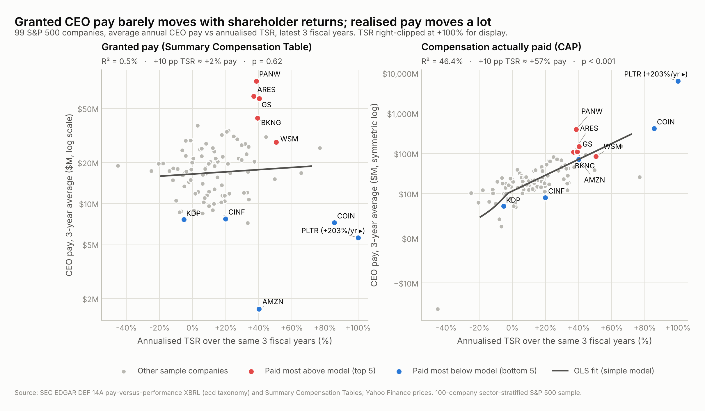
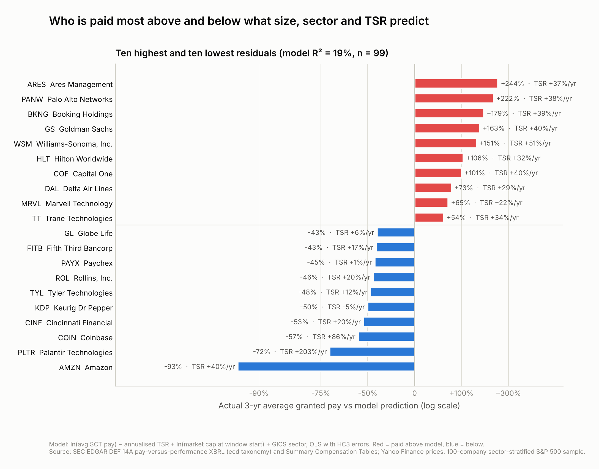
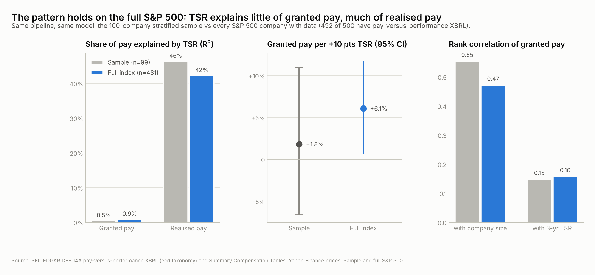

Equity Research · Governance &amp; Compensation · November 2026

<h1>Paid for Size, Barely for Returns</h1>

Do S&amp;P 500 CEOs get paid for shareholder returns? Evidence from 100 companies' SEC pay-versus-performance disclosures

Tyler Quezada · Sector-stratified sample of 100 S&amp;P 500 constituents · 496 CEO-years (FY2021–FY2026)

## Executive summary

- **Granted pay barely tracks returns.** Across 99 companies, annualised 3-year TSR explains **0.5%** of the variation in the pay boards award (Summary Compensation Table). Each extra 10 points of annual TSR is associated with just **+1.8%** more pay after size and sector controls (p = 0.69). Within companies, pay does not respond to the same year's return either (p = 0.81).
- **Realised pay does, largely by construction.** Compensation actually paid (CAP) marks equity to market; TSR explains **46%** of its variation and +10 points of TSR goes with roughly **+58%** more CAP (p < 0.001). Alignment comes from the stock CEOs already hold, not from boards adjusting new awards.
- **Size matters more than performance.** Granted pay ranks with company size (Spearman ρ = 0.55) far more than with TSR (ρ = 0.15). A weak link to TSR exists once four founder/lump-grant companies are set aside (AMZN, COIN, META, PLTR): +10 points of TSR then means **+11.6%** pay (p = 0.001), versus **+24%** for a doubling of market cap.
- **The biggest "overpaid" outliers were strong performers.** ARES, PANW, BKNG, GS, WSM were paid 151–244% above model, but all returned 37–51%/yr. One-time or structural awards explain most of the gap. The "underpaid" end is dominated by founders and lumpy multi-year grants whose *realised* pay is enormous (AMZN, PLTR, COIN), plus 2 CEO transitions (CINF, KDP).
- **Shareholders notice.** Companies paying further above model receive lower say-on-pay support (ρ = -0.30, p = 0.004); TSR itself is unrelated to support. 3 votes failed outright (3M, Palo Alto Networks, Skyworks Solutions).
- **Read proxy TSR with care.** 12 of 100 proxies contain TSR figures that miss market data by more than 10 points, mostly because earlier years were never rebased when the table rolled forward.
- **The pattern holds on the full S&P 500.** Re-run on every index member with data (n = 481): TSR explains 0.9% of granted pay and 42% of realised pay; pay ranks with size 0.47 vs TSR 0.16. With five times the companies, a small granted-pay link becomes detectable (+6.1% per 10 points, p = 0.028). It lies inside the sample's 95% interval (-7% to +11%), so the precise conclusion is that granted pay responds weakly to returns, not that it ignores them (appendix).

## Methodology

**Universe.** 100 of the 500 S&amp;P 500 issuers, drawn by proportional GICS-sector stratification (seed 42; `FULL_UNIVERSE=1` runs all 500).
**Pay.** CEO ("PEO") pay comes from the Item 402(v) pay-versus-performance XBRL (`ecd` taxonomy) in each company's latest DEF 14A, giving up to five fiscal years of SCT total pay, compensation actually paid and company/peer TSR. In multi-CEO years the year-end incumbent is used (flagged).
**Pay mix.** Pay mix is parsed from the Summary Compensation Table HTML. A row is kept only if its components sum to its total *and* that total equals the XBRL figure.
**Performance.** TSR is computed independently from Yahoo Finance prices with dividends reinvested, over each company's own fiscal windows (1, 3 and 5 years; 3 is primary). The proxy-reported TSR serves as a cross-check.
**Models.** OLS with HC3 robust errors: ln(average granted pay) and asinh(average CAP, $M) on annualised TSR (winsorised at 2.5/97.5%), ln(market cap at window start) and sector dummies.
**Outliers.** Outliers are the residuals of the granted-pay model. Say-on-pay votes are parsed from 8-K Item 5.07 filings (247 meetings, 89 companies). Every assumption is logged in `ASSUMPTIONS.md`; automated validation (permutation and bootstrap tests, numpy re-estimation, source-document and claim checks) is in `output/validation/validation_report.md`.

## Key findings

**1. Pay boards grant barely moves with returns; pay CEOs realise moves a lot.** The contrast holds in every window:

| Window | Pay measure | +10 pp annual TSR → pay | p-value | R² (with size + sector) | n |
|---|---|---:|---:|---:|---:|
| 1 yr | Granted (SCT) | +2.5% | p = 0.46 | 20% | 100 |
| 1 yr | Actually paid (CAP) | +73.4% | p < 0.001 | 52% | 100 |
| 3 yr | Granted (SCT) | +1.8% | p = 0.69 | 19% | 99 |
| 3 yr | Actually paid (CAP) | +58.1% | p < 0.001 | 51% | 99 |
| 5 yr | Granted (SCT) | +13.6% | p = 0.047 | 40% | 97 |
| 5 yr | Actually paid (CAP) | +86.7% | p < 0.001 | 45% | 97 |

Granted pay shows a significant link only over five years (+13.6% per 10 points, p = 0.047). The CAP-to-SCT ratio (median 1.25x) has a rank correlation of 0.86 with TSR, and CAP exceeded granted pay in 60% of CEO-years.

**2. The null result is robust, with one important exception.** No reasonable specification turns granted pay into a strong function of TSR:

| Granted-pay specification | +10 pp TSR → pay | p-value | n |
|---|---:|---:|---:|
| Primary (3 yr, size + sector) | +1.8% | p = 0.69 | 99 |
| Raw (un-winsorised) TSR | -1.8% | p = 0.74 | 99 |
| Peer-relative TSR | +4.0% | p = 0.33 | 97 |
| Size = revenue | +0.7% | p = 0.87 | 99 |
| Excl. CEO changes in window | +1.7% | p = 0.75 | 71 |
| CEO-seat pay (all PEOs summed) | +0.2% | p = 0.96 | 99 |
| Excl. no-equity-grant CEOs (AMZN, COIN, META, PLTR) | +11.6% | p = 0.001 | 95 |
| Rank-rank (pay rank on TSR rank + size rank) | slope 0.24 (size 0.59) | p = 0.014 | 99 |

The exception is the last row. AMZN, COIN, META, PLTR paid their CEOs almost nothing in new equity during the window, yet delivered some of the highest returns in the sample. They flatten the linear fit. Without them, a modest positive slope appears. Rank methods, which down-weight such extremes, point the same way (slope 0.24 on TSR rank vs 0.59 on size rank). **Best reading: pay tracks performance weakly at best, and far less than it tracks size.**

**3. Sector view.** CAP's rank correlation with TSR exceeds 0.3 in 10 of 11 sectors; granted pay's does in only 3 (Consumer Staples, Real Estate, Utilities). Median granted pay ranges from $11.6M (Utilities) to $28.6M (Communication Services). With 4–17 firms per sector these are indicative only (`output/charts/02_sector_breakdown.png`).

**4. Pay mix does not predict returns.** The median CEO's 3-year pay is 73% equity, 15% cash incentive and 7% salary; 42% of CEOs received options. Equity share is unrelated to TSR (ρ = -0.06, p = 0.55; excluding the four no-grant CEOs ρ = 0.06). A higher option share went with somewhat lower TSR (ρ = -0.24, p = 0.019), a correlation that likely reflects sector and maturity rather than incentives (`04_pay_mix_by_tsr_quintile.png`).

**5. Shareholders punish the level of pay, not weak returns.** Median say-on-pay support was 92.2%; 18 meetings fell below the 70% level proxy advisers treat as a warning. Support falls as the pay residual rises (ρ = -0.30, p = 0.004) but is unrelated to TSR (ρ = -0.01, p = 0.91). In a linear model controlling for TSR the residual effect is -3.6 points of support per log point of excess pay (p = 0.30), so the effect is real but modest (`05_say_on_pay_vs_residual.png`).

**6. Pay-versus-performance tables contain errors.** Our independent TSR matches the proxy within 1 point for 84% of company-years (median gap 0.07 points). The errors cluster. 9 companies carried earlier-year TSR forward from the prior year's base instead of restating it, and BlackRock tagged its values one year early. Palantir's PvP table shows 2024 CEO pay of $4,630,170 while its Summary Compensation Table shows $4,360,170, a transposition in the same filing ([proxy](https://www.sec.gov/Archives/edgar/data/1321655/000132165526000019/pltr-20260423.htm)). Multi-year proxy TSR should not be used without checking it against market data (`06_tsr_crosscheck.png`).

**7. Excess pay did not predict future returns.** Following Cooper, Gulen &amp; Rau, who found that high "excess pay" firms underperformed in 1994–2011, we formed point-in-time quintiles on the pay residual using only data public at formation. Cohort A used FY2021–23 pay and was formed 2024-09-30; cohort B used FY2022–24 pay and was formed 2025-09-30. CAPM abnormal returns (pre-formation beta, T-bill risk-free rate) show no relation in either cohort: rank correlation +0.03 (p = 0.78) and +0.03 (p = 0.79); most-overpaid minus most-underpaid median +0.0 and -7.5 points. A raw-mean spread of +94 points in cohort A came from one stock (BE), which is why medians are used (`07_strategy_test.png`).

**8. A portfolio backtest agrees.** Rebalanced each 30 September, a portfolio long the most-underpaid fifth and short the most-overpaid fifth (equal-weighted, daily returns 2024-10-01 to 2026-11-04) returned -15.0% in total, with a Sharpe ratio of -0.49. Its CAPM alpha was -1.8% a year (t = -0.22, Newey-West). The raw loss is market exposure, not a pay effect: the overpaid fifth's beta was 1.25 against 0.85 for the underpaid fifth (`08_backtest.png`). On the full index (about 96 stocks per fifth) the alpha is -0.4% a year (t = -0.09).

## Outliers: who is paid most above and below the model

Residuals from the primary model (granted pay on TSR, start-of-window size and sector; R² = 19%). "vs model" is actual pay relative to the model's prediction.

**Paid most above model ("overpaid relative to performance and size")**

| # | Company | CEO (latest FY) | Avg pay 3y | Model | vs model | TSR %/yr | Likely driver |
|---|---|---|---:|---:|---:|---:|---|
| 1 | **ARES** Ares Management | Michael J Arougheti | $61.4M | $17.9M | +244% | +37% | Incentive-fee allocations swapped for restricted units (2024-25) |
| 2 | **PANW** Palo Alto Networks | Nikesh Arora | $79.3M | $24.7M | +222% | +38% | Large annual PSU grants after a 2023 one-time retention award |
| 3 | **BKNG** Booking Holdings | Fogel | $42.3M | $15.2M | +179% | +39% | High target pay; peer group includes mega-cap tech |
| 4 | **GS** Goldman Sachs | Solomon | $59.1M | $22.5M | +163% | +40% | $80M one-time retention RSUs (Jan 2025) |
| 5 | **WSM** Williams-Sonoma, Inc. | Laura Alber | $28.2M | $11.3M | +151% | +51% | Not investigated in depth; no special award found in proxy scan |

**Paid most below model ("underpaid")**

| # | Company | CEO (latest FY) | Avg pay 3y | Model | vs model | TSR %/yr | Likely driver |
|---|---|---|---:|---:|---:|---:|---|
| 99 | **AMZN** Amazon | Andrew R. Jassy | $1.7M | $22.9M | -93% | +40% | No CEO equity grant since the 2021 promotion award |
| 98 | **PLTR** Palantir Technologies | Karp | $5.6M | $19.6M | -72% | +203% | Founder; pre-IPO mega-grant, no new awards |
| 97 | **COIN** Coinbase | Armstrong | $7.2M | $16.6M | -57% | +86% | Founder; 2020 performance option, no new awards |
| 96 | **CINF** Cincinnati Financial | Stephen M. Spray | $7.7M | $16.4M | -53% | +20% | CEO transition in window (flag); not investigated in depth |
| 95 | **KDP** Keurig Dr Pepper | Timothy Cofer | $7.6M | $15.3M | -50% | -5% | CEO transition in window (flag); not investigated in depth |

All five above-model companies stay in the top 7 when sector dummies are dropped and in the top 7 on a 5-year window. All five below-model companies stay in the bottom 7 without sector dummies or when the model is estimated without the no-grant companies. On a 5-year window Amazon moves to the middle (rank 54) because that window includes its 2021 mega-grant, which independently confirms the timing explanation below. Because TSR barely moves predicted pay, these residuals mostly measure **pay relative to size and sector**. The classic case of high pay for weak returns appears instead in a misalignment screen of above-model pay with below-median TSR: OMC (+54%, TSR +3%/yr), PEP (+48%, TSR -4%/yr), AEP (+46%, TSR +11%/yr), YUM (+39%, TSR +8%/yr), DOW (+37%, TSR -18%/yr).

## Case studies

**Ares Management (ARES), Michael Arougheti: a pay structure, not a pay spike.** *3-yr avg granted pay $61.4M vs $17.9M predicted (+244%, rank 1 of 99); TSR +37%/yr; avg CAP $108.9M.*
Arougheti draws no salary; Ares pays senior professionals mainly through carried interest and fund incentive fees. In January 2024 the board granted him **400,000 restricted units in exchange for reducing his incentive-fee allocations**, plus **250,000 more in January 2025** ([2026 proxy](https://www.sec.gov/Archives/edgar/data/1176948/000162828026026286/ares-20260420.htm); first described in the [2024 proxy](https://www.sec.gov/Archives/edgar/data/1176948/000162828024016964/ares-20240419.htm)). That conversion turns fee income into grant-date "stock awards": his reported stock awards rose from $13.7M (2023) to $62.6M (2024) and $49.5M (2025), on top of $18.8M of 2025 "all other compensation" that the proxy attributes mainly to incentive-fee payments and carried-interest distributions. Ares is a controlled company and holds say-on-pay votes only every three years (last vote 92% (2025)). **Verdict:** explained. Alternative-asset-manager economics (performance fees routed through pay) and a one-off fee-for-equity swap, not a discretionary raise. Comparing ARES with corporate CEOs overstates "overpayment."

**Palo Alto Networks (PANW), Nikesh Arora: mega-grants and a failed vote.** *3-yr avg granted pay $79.3M vs $24.7M predicted (+222%, rank 2 of 99); TSR +38%/yr; avg CAP $395.5M.*
In fiscal 2023 the board gave Arora a one-time performance-based RSU retention award; reported pay that year was $151.4M. Annual equity in FY2024–FY2026 remained very large ($58.0M, $99.7M, $80.3M). Shareholders supported pay with only 50% (2024), 46% (2025) at the December meetings ([8-K](https://www.sec.gov/Archives/edgar/data/1327567/000119312525315915/d15273d8k.htm)); the company's latest proxy calls the 46% result "a call to action" and commits to no further overlapping one-time CEO awards and to fully performance-based FY2026 NEO equity ([2026 proxy](https://www.sec.gov/Archives/edgar/data/1327567/000130817926000432/panw-20261027.htm)). Bloomberg reports seven rejected pay votes since 2015, the most in the S&amp;P 500 ([The Next Web](https://thenextweb.com/news/palo-alto-networks-arora-100m-pay-shareholders-reject)). **Verdict:** explained by deliberate mega-grants. TSR was strong, but shareholders judged the quantum excessive. This is the clearest governance case in the sample.

**Booking Holdings (BKNG), Glenn Fogel: no single event.** *3-yr avg granted pay $42.3M vs $15.2M predicted (+179%, rank 3 of 99); TSR +39%/yr; avg CAP $110.2M.*
Fogel's pay was consistently high ($46.7M, $44.8M, $35.4M for 2023–25), almost all PSUs and RSUs ($40.9M, $38.8M, $26.2M in stock awards). There was no one-time award. The compensation peer group mixes travel peers with mega-cap technology firms (Alphabet, Amazon, Meta, Microsoft, Adobe, Uber), which supports a high pay level ([2026 proxy](https://www.sec.gov/Archives/edgar/data/1075531/000130817926000310/bkng-20260420.htm)). 2025 pay fell as stock awards shrank ([Skift](https://skift.com/2026/04/14/booking-ceo-glenn-fogel-took-pay-cut-in-2025-after-2-big-years/)). Say-on-pay support stayed high: 90% (2024), 88% (2025), 90% (2026). **Verdict:** no clear one-off reason. The gap reflects a sustained board choice to pay at a mega-cap tech level, which shareholders accepted given +39%/yr returns. "Overpaid relative to size", but arguably paid for performance.

**Amazon (AMZN), Andy Jassy: a lumpy grant, not a pay cut.** *3-yr avg granted pay $1.7M vs $22.9M predicted (-93%, rank 99 of 99); TSR +40%/yr; avg CAP $71.7M.*
Jassy received no equity award in 2023–25. His reported pay was salary ($365,000) plus security and other costs. Amazon's proxy states the committee "has not granted Mr. Jassy an equity award since 2021" and that more than 80% of his 2021 promotion award vests in 2026–2031 ([2026 proxy](https://www.sec.gov/Archives/edgar/data/1018724/000110465926041026/tm261382-1_def14a.htm)). That 2021 award put his 2021 reported pay at $212.7M. Spread over its 10-year schedule it is about $21.3M a year, close to our model's $22.9M prediction. Say-on-pay: 77% (2024), 78% (2025), 94% (2026). **Verdict:** explained. A timing artifact of multi-year front-loaded grants. Amazon is "underpaid" only in years without a grant.

**Palantir (PLTR), Alex Karp: lowest reported pay, highest realised pay.** *3-yr avg granted pay $5.6M vs $19.6M predicted (-72%, rank 98 of 99); TSR +203%/yr; avg CAP $6.3B.*
Karp's reported pay is salary ($1.1M) plus security and other costs. His wealth comes from pre-IPO awards under the Executive Equity Plan: options on **141 million Class B shares at $11.38** plus RSUs ([2026 proxy](https://www.sec.gov/Archives/edgar/data/1321655/000132165526000019/pltr-20260423.htm); [CNBC](https://www.cnbc.com/2021/04/29/palantir-ceo-karp-earned-1point1-billion-in-2020-tied-to-equity-awards.html)). As the stock rose +203%/yr, CAP reached $1.1B, $6.8B and $11.1B in 2023–25, the largest in the sample ([Fortune](https://fortune.com/2025/05/05/palantir-ceo-pay-alex-karp/)). Founders hold up to 49.999999% of voting power through Class F stock, so the 84% (2026) say-on-pay result is not an independent verdict. **Verdict:** explained. Founder with a legacy mega-grant: "underpaid" on paper, the opposite in reality.

**Coinbase (COIN), Brian Armstrong: a 10-year option, priced in 2020.** *3-yr avg granted pay $7.2M vs $16.6M predicted (-57%, rank 97 of 99); TSR +86%/yr; avg CAP $413.9M.*
The board has made no new equity grant to Armstrong since the August 2020 **CEO Performance Award**, a 10-year option on 9,293,911 shares that vests only at stock-price hurdles, starting after roughly 750% price growth and fully vesting around 1,600%. The board "does not anticipate" further awards during its term ([2026 proxy](https://www.sec.gov/Archives/edgar/data/1679788/000167978826000045/coin-20260424.htm); [Blockworks](https://blockworks.co/news/coinbase-ceo-compensation-bear-market)). Reported pay is a $1.0M salary plus personal security and aircraft costs ($7.6M and $1.1M in 2025, per the proxy). CAP swung with the stock: $680.9M, $523.6M, $37.2M in 2023–25. Armstrong controls a majority of the vote (controlled company), and say-on-pay passed with 98% (2025). **Verdict:** explained. Founder pay is front-loaded into a single price-hurdle option.

**Also notable.** *Goldman Sachs (#4 above model):* 2025 pay of $118.9M includes **$80M of retention RSUs** that cliff-vest in January 2030 with no performance condition ([2026 proxy](https://www.sec.gov/Archives/edgar/data/886982/000119312526117433/gs-20260319.htm)). Excluding it, 2025 pay was $38.9M. Support fell to 66% in 2025 from 86%, the weakest in about a decade, with ISS and Glass Lewis opposed ([Banking Dive](https://www.bankingdive.com/news/goldman-shareholders-back-80m-packages-for-solomon-waldron/746287/); [American Banker](https://www.americanbanker.com/news/goldman-shareholders-ok-executive-pay-but-with-less-support)). *Omnicom (#1 on the misalignment screen):* Wren's 2025 pay of $69.9M is almost entirely a **4,000,000-share option at $77.60** ($69.3M grant value) granted in May 2025 when he cut his salary to $1 and gave up other incentive pay through fiscal 2028 ([2026 proxy](https://www.sec.gov/Archives/edgar/data/29989/000121390026034811/ea0274271-02.htm); [8-K](https://www.sec.gov/Archives/edgar/data/29989/000121390025043442/ea0242158-8k_omnicom.htm)). Spread over 2025–28 it is about $17.5M a year, below his 2023–24 average of $20.9M. Shareholders still objected: support fell from 90% to 56% ([Campaign](https://www.campaignlive.com/article/omnicom-ceo-john-wren-earned-70m-package-2025/1953453); [AdNews](https://www.adnews.com.au/news/omnicom-s-ceo-pay-was-cut-to-1-and-a-lot-of-shareholders-aren-t-impressed)). In both cases a 3-year average flatters or penalises a single front-loaded award.

## Limitations

- **Sample and survivorship.** n = 99 current constituents. Firms that left the index after poor returns are missing, which biases TSR upward and may hide underperformers with high pay.
- **Short history.** PvP disclosure began with 2023 proxies, so at most five fiscal years (FY2021–FY2025 for most companies) are available. Grant-date SCT values are lumpy (AMZN, OMC, GS), and averaging only partly smooths them.
- **CAP is a paper measure.** CAP is mechanically linked to stock price, and companies apply the valuation rules unevenly. Its correlation with TSR is partly by construction.
- **Measurement.** Fiscal windows differ by year-end. Start-of-window market cap is approximated from current market cap and price change, ignoring buybacks. CEO-transition years use the incumbent (28 companies had a change within the 3-year window).
- **Filing quality.** XBRL tagging errors exist (stale TSR bases, misdated values, Palantir's transposed pay figure). We use independent TSR and double-reconciled pay mix to contain them, but undetected errors remain possible.
- **Say-on-pay coverage.** Votes were parsed for 89 of 100 companies. Support at controlled companies (ARES, COIN, PLTR) mostly reflects insider votes.
- **Causality.** All results are associations. Boards may set pay ex ante on expected performance, which cross-sectional data cannot identify.

## Conclusion

In this sample, boards set CEO pay mainly by company size and peer benchmarks; awarded pay responds little to the returns shareholders receive. Pay-for-performance alignment is real but runs through the stock: equity grants become worth far more or far less as the share price moves, which is why realised pay tracks TSR closely. The largest deviations from the size-and-sector norm come from deliberate structural choices: mega-grants at Palo Alto, fee-for-equity swaps at Ares, retention awards at Goldman, front-loaded options at Omnicom, and founder grants at Palantir, Coinbase and Amazon. They do not come from boards rewarding weak results. Investors should judge pay on realised outcomes and grant frequency rather than single-year headline numbers. They should also check proxy TSR against market data before relying on it.

## Appendix: replication on the full S&P 500

The same pipeline and model were re-run on every S&P 500 company. 492 of 500 have pay-versus-performance XBRL; the rest are recent listings or spin-offs without a full proxy yet. For the full index, size comes from SEC-reported shares outstanding × price because Yahoo's quote service refused bulk requests. On the 100 sample companies the two measures agree within 10% for 97 (correlation 0.99; exceptions KMB, ARES, SWKS reflect share classes and pending mergers).

| Measure | 100-company sample | Full S&P 500 |
|---|---|---|
| Companies in the 3-year model | 99 | 481 |
| Share of granted pay explained by TSR (R²) | 0.5% | 0.9% |
| Granted pay per +10 pts TSR (size + sector) | +1.8% (p = 0.69) | +6.1% (p = 0.028) |
| Share of realised pay explained by TSR (R²) | 46% | 42% |
| Realised pay per +10 pts TSR | +58% | +40% |
| Rank correlation of pay with size / with TSR | 0.55 / 0.15 | 0.47 / 0.16 |
| Granted pay per +10 pts TSR, 5-year window | +13.6% (p = 0.047) | +15.1% (p = 0.027) |
| Same, excluding CEOs with no equity grant in window | +11.6% (p = 0.001; 4 excluded) | +8.5% (p < 0.001; 30 excluded) |
| Say-on-pay support vs excess pay (Spearman) | -0.30 (p = 0.004) | -0.30 (p < 0.001) |
| Excess pay → later abnormal return (rank IC, cohorts A / B) | +0.03 / +0.03 | +0.01 / +0.02 |
| Long-short backtest CAPM alpha per year (t) | -1.8% (-0.22) | -0.4% (-0.09) |
| Companies with proxy TSR errors > 10 pts | 12 | 69 |
| XBRL pay found in the proxy (verbatim or within the filer's rounding) | 100/100 | 492/492 |
| Say-on-pay parse agrees with company-reported figure | 57/57 | 274/295 |

Full-index top residuals: above model TSLA, WELL, ARES, ORCL, CRWD; below model XYZ, ABNB, TTWO, DASH, AMZN. The case studies above cover the sample; the full-index list is shown for transparency. Tesla's figure is Musk's 2025 award ($158.4B in the Summary Compensation Table) averaged with a $0 year; Devon Energy, which tagged its pay in thousands, was rescaled (ASSUMPTIONS F5–F7). Say-on-pay disagreements on the full index were spot-checked by hand: for S&P Global, Seagate and Expedia our parse matches the company's own words and the checker had read a different year's figure; Workday (dual-class shares) is unresolved.

<b>Data.</b> SEC EDGAR: DEF 14A pay-versus-performance XBRL (ecd taxonomy), Summary Compensation Tables, 8-K Item 5.07 vote results. Yahoo Finance: prices, dividends, market cap. Wikipedia: S&amp;P 500 constituents (CIKs verified against SEC). Results file: <code>output/results.json</code>. Full assumption log: <code>ASSUMPTIONS.md</code>.

